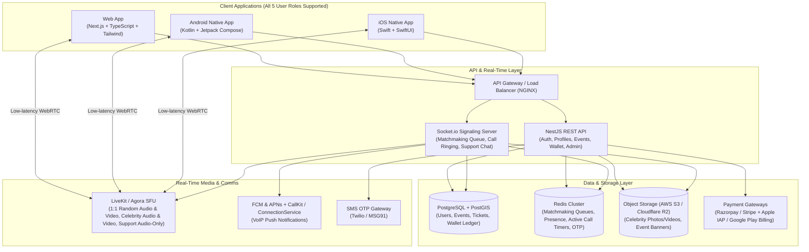
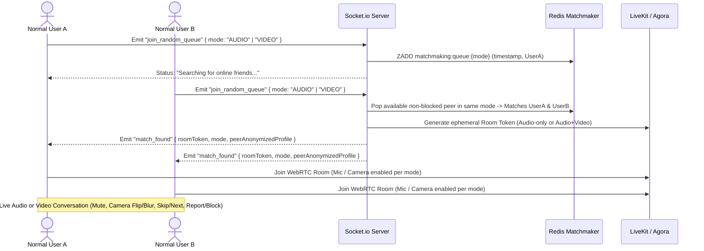
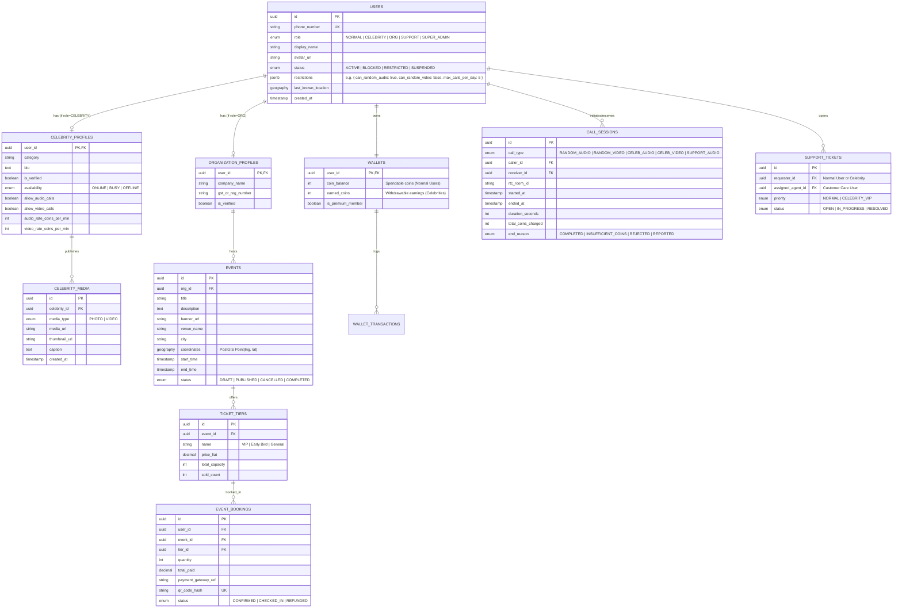

> **Source:** Gemini's implementation plan from the Antigravity "Friends Connect" chat, approved by Nikhil on 26 Oct 2026. Kept unchanged for reference — it describes the *target* architecture. What is actually built today is in [STATUS.md](STATUS.md).

# Friends Connect — System Architecture & Implementation Plan

> [!NOTE]
> **Project Scope**: A multi-platform social discovery, celebrity interaction, and event ticketing ecosystem featuring **100% platform-native mobile apps** (Android in Kotlin/Jetpack Compose, iOS in Swift/SwiftUI), a **unified Web application** (Next.js), and a **scalable real-time backend** (NestJS, PostgreSQL/PostGIS, Redis, Socket.io, and LiveKit/Agora).

---

## 1. High-Level System Architecture



---

## 2. Call & Communication Matrix Across Roles

To ensure clarity on calling permissions across the platform:

| Caller $\rightarrow$ Receiver | Audio Call | Video Call | Live Chat | Billing / Access |
| :--- | :---: | :---: | :---: | :--- |
| **Normal User $\leftrightarrow$ Normal User (Random Match)** | ✅ Yes | ✅ Yes | ❌ No | Free / Standard Random Matchmaking |
| **Normal User $\rightarrow$ Celebrity User** | ✅ Yes | ✅ Yes | ❌ No | **Premium / Wallet Coins** (Per-minute rate) |
| **Normal User $\leftrightarrow$ Customer Care Support** | ✅ Yes | ❌ **No** | ✅ Yes | Free Support (Audio Call & Chat only) |
| **Celebrity User $\leftrightarrow$ Customer Care Support** | ✅ Yes | ❌ **No** | ✅ Yes | Free VIP Support (Audio Call & Chat only) |

---

## 3. User Roles & Feature Matrix

All **5 user roles** are accessible across **Web, Android Native, and iOS Native** (via role-based navigation and dashboards):

| Role | Key Capabilities |
| :--- | :--- |
| **1. Normal User** | • Mobile Number + OTP Login & Profile setup<br>• **1-Tap Random Friend Matchmaking (Audio & Video)**: Choose **Random Audio Call** or **Random Video Call** (or upgrade from Audio to Video mid-call with mutual consent) to connect with online peers<br>• **Location-Based Events**: Discover nearby events (PostGIS radius filter), book tickets, view QR passes<br>• **Celebrity Feed & Calling (Audio & Video)**: View celebrity photos/videos, recharge Wallet Coins/Premium, place per-minute **Audio Calls** or **Video Calls** to celebrities<br>• **Customer Care Support**: Live chat & **Audio-only** call with Customer Care |
| **2. Celebrity User** | • Dedicated Celebrity Profile & Verification badge<br>• **Media Feed Management**: Upload photos, short videos, and updates<br>• **Call & Rate Management**: Toggle availability (`Online` / `Busy` / `Offline`), set custom per-minute coin rates separately for **Audio Calls** and **Video Calls**, accept/reject incoming user calls<br>• **Earnings Dashboard**: Track coins earned per call & request payouts<br>• **Customer Care Support**: Dedicated priority chat & **Audio-only** call with Customer Care |
| **3. Organization User** | • Organization Profile & KYC verification<br>• **Event Creation & Listing**: Publish events with GPS coordinates, venue, date/time, banner media, and multi-tier ticket pricing (Free/Paid)<br>• **Ticket & Attendee Management**: Real-time ticket sales analytics, attendee list, and QR ticket scanner (in-app camera on Android/iOS/Web) |
| **4. Customer Care Support** | • **Support Queue Dashboard**: View incoming support tickets, live chats, and incoming support **audio calls** from both **Normal Users** and **Celebrities**<br>• **Two-Way Comms (Audio + Chat Only)**: Initiate or receive real-time chat & **audio-only calls** (video track strictly disabled at token level) to resolve user/celebrity issues, escalate to Super Admin |
| **5. Super Admin** | • **Full Platform Control**: Approve/verify Organizations & Celebrities<br>• **Moderation & Restrictions**: Block, suspend, rate-limit, or restrict any user/celebrity/organization (e.g., restrict camera/video access for reported users); review abuse reports from random audio/video calls<br>• **Financials & Config**: Configure coin packages, platform commission %, event payout settlements, and system-wide feature flags |

---

## 4. Core Technical Workflows

### 4.1 Random Friend Audio & Video Call Matchmaking (Redis + Socket.io + LiveKit/Agora)
Users can either join a dedicated **Random Audio Queue** or **Random Video Queue**, or request a camera switch during an active audio call:



### 4.2 Celebrity Per-Minute Audio & Video Call + Wallet Metering
> [!IMPORTANT]
> **Real-Time Per-Minute Coin Billing**: Video calls and Audio calls have independent per-minute coin rates (`audio_rate_coins_per_min` vs. `video_rate_coins_per_min`). A Redis-backed **Call Metering Worker** ticks every 60 seconds while the call is active.

1. **Pre-Call Check**: Normal User selects `Audio Call` or `Video Call` on a Celebrity profile. Backend verifies:
   - User has an active Premium/Wallet balance $\ge$ `2 × selected_mode_rate` (Audio rate or Video rate).
   - Celebrity status is `ONLINE` and not currently in another call.
2. **Ringing & Native VoIP Push**:
   - **iOS**: Backend sends APNs VoIP Push $\rightarrow$ triggers native **CallKit** full-screen incoming call UI (`hasVideo = true` for Video Calls, `false` for Audio Calls).
   - **Android**: Backend sends High-Priority FCM $\rightarrow$ triggers **ConnectionService / Foreground Call Style Notification** indicating Audio or Video call.
   - **Web**: Socket.io triggers incoming Audio/Video call modal with ringtone.
3. **Active Call & Billing**:
   - Once Celebrity accepts, both join the encrypted LiveKit/Agora room with video track permissions matching the call type.
   - Every billing cycle, the backend atomically deducts coins from the User's Wallet and credits the Celebrity's Earnings Ledger (minus platform commission).
   - If the User's balance reaches `< 1 minute remaining`, an in-call warning toast is emitted (`"Low balance: Recharge now or call ends in 60s"`). At `0` coins, the room is gracefully terminated by the server.

### 4.3 Customer Care Support (Strict Audio-Only + Chat)
- Normal Users and Celebrities can contact Customer Care via **Live Chat** or **Audio Call**.
- When generating the LiveKit/Agora WebRTC token for `SUPPORT_AUDIO` sessions, the backend explicitly sets `canPublishSources: [MICROPHONE]` (blocking `CAMERA` and `SCREEN_SHARE` at the media server level) so video is never possible during support calls.

### 4.4 Location-Based Events & Ticketing (PostGIS)
- **Geospatial Discovery**: Events are stored with a `GEOGRAPHY(Point, 4326)` column in PostgreSQL (PostGIS).
- When a Normal User opens the Events tab, the app sends `(latitude, longitude, radius_km)`.
- Query uses `ST_DWithin(event.location, ST_MakePoint(lng, lat)::geography, radius_meters)` sorted by distance and start date.
- **Ticketing**: Users select ticket tiers $\rightarrow$ checkout via Razorpay/Stripe $\rightarrow$ webhook confirms payment $\rightarrow$ generates a cryptographically signed QR Ticket (`HMAC-SHA256(ticket_id + user_id + event_id)`).

---

## 5. Database Schema Design (PostgreSQL + PostGIS)



---

## 6. Repository & Project Structure

```text
Friends Connect App/
├── docs/                          # Architecture, OpenAPI/Swagger specs, WebSocket event contracts
├── backend/                       # NestJS + TypeScript + Prisma/TypeORM + PostgreSQL/PostGIS + Redis + Socket.io
│   ├── src/
│   │   ├── auth/                  # Mobile OTP Auth, JWT + Refresh Tokens, Role Guards
│   │   ├── matchmaking/           # Redis Queues (Audio & Video) + Socket.io Gateway for Random Calls
│   │   ├── calls/                 # LiveKit/Agora Token Service (Audio/Video permissions), Celebrity Call Metering
│   │   ├── celebrities/           # Profiles, Photo/Video Feed (S3 presigned URLs), Audio/Video Rate Config
│   │   ├── events/                # PostGIS Geo-queries, Org Event CRUD, QR Ticket Booking
│   │   ├── wallet/                # Coin Packages, Razorpay/Stripe Webhooks, Per-minute Ledger
│   │   ├── support/               # Customer Care Chat & Audio-Only Call Routing (User & Celebrity queues)
│   │   └── admin/                 # Super Admin User Moderation, Restrictions, Blocklists, Analytics
├── web/                           # Next.js (App Router) + TypeScript + Tailwind CSS + LiveKit Web SDK
│   ├── src/app/
│   │   ├── (auth)/                # OTP Login & Role Onboarding
│   │   ├── (user)/                # Random Audio/Video Call Radar, Nearby Events, Celebrity Feed, Wallet
│   │   ├── (celebrity)/           # Media Studio, Audio/Video Call Rates & Availability, Incoming Call Console
│   │   ├── (organization)/        # Event Publisher, Ticket Tiers, Live Sales & Web QR Scanner
│   │   ├── (support)/             # Omnichannel Customer Care Agent Desk (Chat + Audio-Only Call)
│   │   └── (admin)/               # Super Admin Command Center (User Blocks, Video Restrictions, KPIs)
├── android/                       # 100% Native Android App (Kotlin + Jetpack Compose + Clean Architecture)
│   ├── app/src/main/java/com/friendsconnect/
│   │   ├── core/                  # Retrofit/OkHttp, Socket.io Client, LiveKit Android SDK, Room DB
│   │   ├── telecom/               # Android ConnectionService & Foreground Audio/Video Call Service
│   │   └── ui/                    # Compose Screens for Normal User, Celebrity, Org, Support, Admin
└── ios/                           # 100% Native iOS App (Swift 6 + SwiftUI + MVVM-C)
    ├── FriendsConnect/
    │   ├── Core/                  # URLSession/Async-Await Networking, Socket.io-Client-Swift, LiveKit Swift SDK
    │   ├── VoIP/                  # PushKit + CallKit Provider Delegate (Audio & Video support)
    │   └── Features/              # SwiftUI Views for Normal User, Celebrity, Org, Support, Admin
```

---

## 7. Phased Implementation Roadmap

### Phase 1: Backend Core, Auth & Database Setup
1. **Docker Infrastructure**: `docker-compose.yml` for PostgreSQL (with PostGIS extension), Redis, and LiveKit Server (local dev).
2. **Auth & RBAC Module**: Mobile Number + OTP generation/verification, JWT issuance, Role-based guards (`NORMAL`, `CELEBRITY`, `ORG`, `SUPPORT`, `SUPER_ADMIN`), and Super Admin restriction middleware (including separate audio vs. video call permissions).
3. **Database Migrations**: Prisma / TypeORM schema with PostGIS spatial indexes for `EVENTS` and updated `CALL_SESSIONS` enums (`RANDOM_AUDIO`, `RANDOM_VIDEO`, `CELEB_AUDIO`, `CELEB_VIDEO`, `SUPPORT_AUDIO`).

### Phase 2: Real-Time Calling Engine (Audio + Video) & Wallet System
1. **Random Friend Matchmaking (Audio & Video)**: Socket.io gateway + Redis atomic matchmaking queues (`matchmaking:queue:audio` and `matchmaking:queue:video`), mutual blocklist filtering, mid-call Audio-to-Video upgrade handshake, and LiveKit/Agora token generation.
2. **Wallet & Coin Ledger**: Coin purchase APIs, payment webhook handlers, and atomic transaction ledger.
3. **Celebrity Audio & Video Call Metering Engine**: Call ringing state machine, separate per-minute billing rates for Audio and Video calls, background tick worker for coin deduction, and automatic disconnect on zero balance.

### Phase 3: Events, Celebrity Media & Customer Care APIs
1. **Organization & Events API**: Geo-radius event search (`ST_DWithin`), event creation, ticket tier inventory locking, and QR ticket generation/verification.
2. **Celebrity Media Feed**: S3/R2 pre-signed URL upload flow for celebrity photos and videos, paginated feed API.
3. **Customer Care & Super Admin API**: Real-time support chat rooms, support **audio-only** call queue (prioritizing Celebrities), and Super Admin moderation endpoints (block, limit, disable video calling, or restrict users).

### Phase 4: Web Application (Next.js)
1. **Unified Multi-Role Web Portal**: Responsive UI with dedicated role workspaces.
2. **WebRTC Integration**: Browser-based Audio & Video call UI for Random Calls and Celebrity Calls (with camera preview, flip, blur, and mute), plus an **Audio-Only + Chat** console for Customer Care Agents.
3. **Interactive Event Discovery**: Browser geolocation integration + interactive event cards and ticket checkout.

### Phase 5: Native Android Application (Kotlin + Jetpack Compose)
1. **Architecture & Networking**: Hilt DI, Retrofit, Kotlin Coroutines/Flow, Socket.io, and LiveKit Android SDK.
2. **Native Calling Experience**: Foreground Call Service + `ConnectionService` supporting both Audio and Video calls (Picture-in-Picture support for video calls) and Audio-only for Customer Care.
3. **Role Screens & Camera QR Scanner**: Compose UI for all user flows, MLKit/CameraX for Organization ticket scanning, and Google Play Billing / Razorpay SDK integration.

### Phase 6: Native iOS Application (Swift + SwiftUI)
1. **Architecture & Networking**: Swift Concurrency (`async/await`), Combine, Socket.io-Client-Swift, and LiveKit Swift SDK.
2. **CallKit & PushKit Integration**: Native iOS lock-screen incoming call experience (`hasVideo` configured dynamically for Random/Celebrity Video calls, and disabled for Support calls).
3. **Role Screens & AVFoundation Scanner**: SwiftUI views for all roles, PiP video call view, native QR scanner for Organizations, and StoreKit 2 / Razorpay integration.

---

## 8. Security, Moderation & Video Safety Controls
- **Granular Video & Audio Restrictions**: Super Admin can selectively revoke a user's `can_random_video` permission (restricting them to audio-only) or ban their account if they violate community guidelines during a random video call.
- **Strict Media Enforcement on Support Calls**: Customer Care calls (`SUPPORT_AUDIO`) have video publishing disabled at the WebRTC token level (`canPublishSources: [MICROPHONE]`), ensuring video can never be turned on during customer support calls.
- **Privacy & In-Call Reporting**: Phone numbers are never exposed between peers; 1-tap "Report & Block" during any random audio or video call immediately disconnects the session, captures metadata for Super Admin review, and permanently blocks future pairing.
